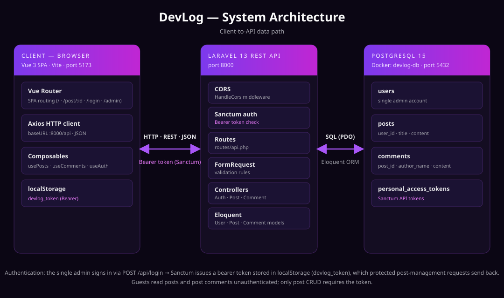
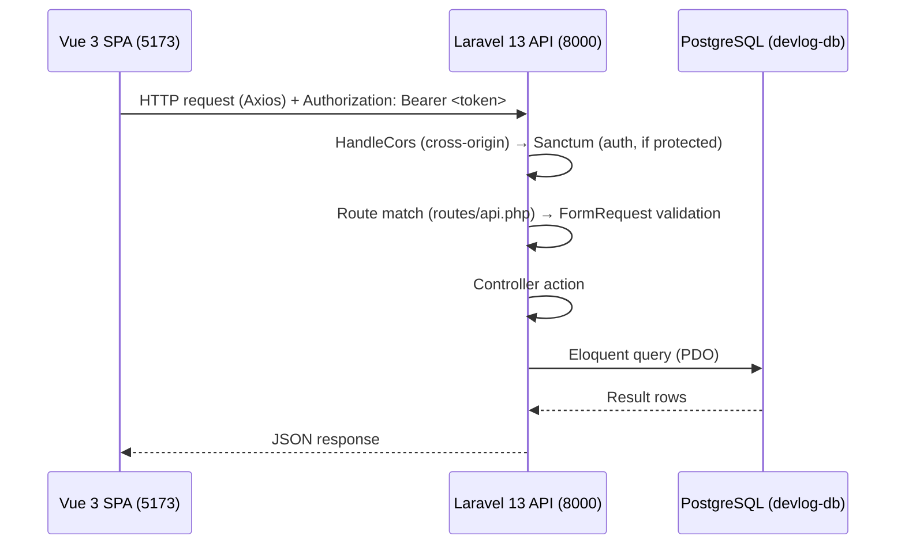
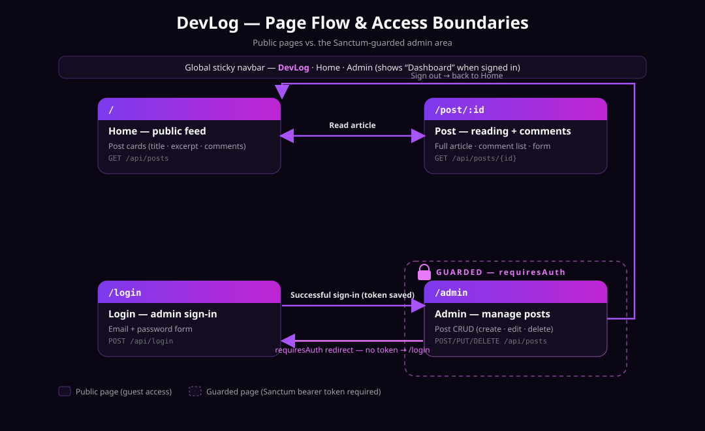
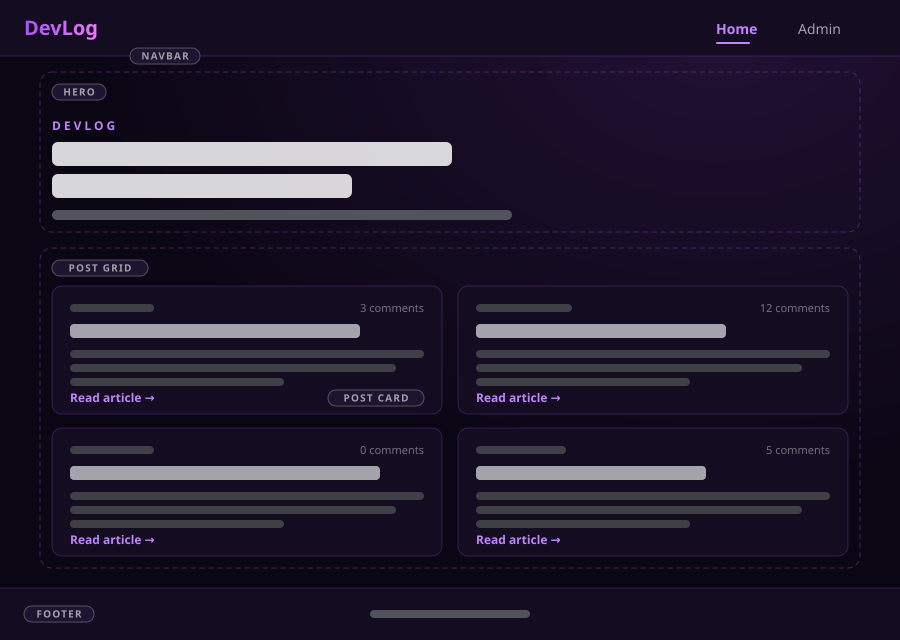
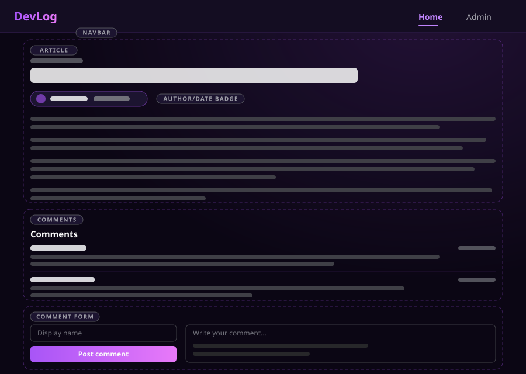
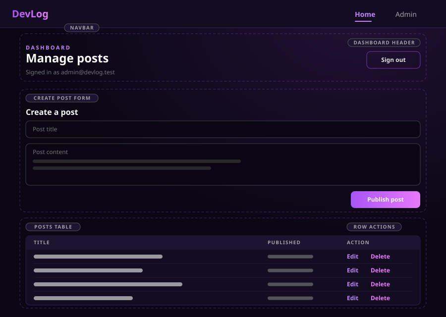

# DevLog — Architecture & Scope

**Project:** DevLog — a focused development journal & tech insights platform.

DevLog is a decoupled web application: a Vue 3 single-page application (SPA) talks to a
Laravel REST API, which persists data in PostgreSQL. The site publishes technical articles
to the public, lets visitors comment as guests, and reserves all content management for a
single authenticated administrator.

---

## 1. Tech Stack Overview

| Layer | Technology | Notes | Port |
| --- | --- | --- | --- |
| Client | Vue 3 (Vite) | SPA, single-page routing, reactive composables | `5173` |
| Styling | Tailwind CSS | Utility-first CSS via `@tailwindcss/vite` | — |
| Routing | Vue Router | `/`, `/post/:id`, `/login`, `/admin` | — |
| HTTP client | Axios | Base URL `http://localhost:8000/api`, bearer-token interceptor | — |
| API | Laravel 13 (PHP 8.3+) | REST + JSON, FormRequest validation, Eloquent ORM | `8000` |
| Auth | Laravel Sanctum | Bearer-token API authentication | — |
| Database | PostgreSQL 15 | Runs in Docker container `devlog-db` | `5432` |

- **Frontend** lives in [`/frontend`](../frontend) and is built/run independently with Vite.
- **Backend** is the Laravel application at the repository root; routes are registered in
  [`routes/api.php`](../routes/api.php).
- **Database** is PostgreSQL. The application's `.env.example` targets a `devlog` database on
  `127.0.0.1:5432` (`DB_CONNECTION=pgsql`); in the development environment the server runs as a
  Docker container named `devlog-db`.

---

## 2. System Architecture



The browser loads the Vue 3 SPA, which renders views and fetches data over HTTP/REST/JSON.
Every request to `/api/*` is handled by Laravel, which applies CORS and (where required)
Sanctum authentication before routing to a controller. Controllers validate input with
`FormRequest` classes and persist/read data through Eloquent models against PostgreSQL.

### Client-to-API data path



---

## 3. Authentication & Scope

### Single-Admin model (no public registration)

DevLog intentionally uses a **single-administrator** authentication model. There is **no
public user registration** and **no multi-user account system**; this keeps the project's
CRUD scope focused on content management by one author.

- The sole admin account is **seeded** by [`database/seeders/DatabaseSeeder.php`](../database/seeders/DatabaseSeeder.php):

  | Field | Value |
  | --- | --- |
  | Email | `admin@devlog.test` |
  | Name | `DevLog Admin` |
  | Password | `password` |

  `DatabaseSeeder` uses `User::updateOrCreate(...)` and then calls `PostSeeder`, so the
  account is created (or kept in sync) on `php artisan db:seed`.

- [`database/seeders/PostSeeder.php`](../database/seeders/PostSeeder.php) seeds **5 sample
  posts** authored by the admin, so the feed is populated on first run. It is idempotent
  (`firstOrCreate`), so re-running it does not duplicate posts:

  ```bash
  php artisan db:seed --class=PostSeeder
  ```

- The admin authenticates through `POST /api/login` ([`AuthController@login`](../app/Http/Controllers/AuthController.php)),
  which verifies the credentials and issues a **Sanctum personal access token**
  (`devlog-admin`).
- The token is stored by the SPA in `localStorage` (`devlog_token`) and attached to subsequent
  requests via an Axios interceptor as `Authorization: Bearer <token>`.

### Roles: guests vs. administrator

| Role | Capabilities | Authentication |
| --- | --- | --- |
| **Guest (visitor)** | Read the post feed, read full posts, submit comments with a display name | None — public endpoints |
| **Administrator** | Everything a guest can do, **plus** create / update / delete posts | Sanctum bearer token |

Public **commenting** does not require an account: visitors supply a display name
(`author_name`) and message (`content`). Only **post management** is protected by
`auth:sanctum`.

### Access boundaries



- `/` (Home), `/post/:id` (Post), and `/login` are **public**.
- `/admin` is **guarded**: Vue Router's `requiresAuth` meta flag checks for a stored token and
  redirects unauthenticated users to `/login`.
- A successful sign-in navigates to `/admin` (or the originally requested `?redirect` target);
  sign-out returns the admin to `/`.

---

## 4. API Surface

All routes are prefixed with `/api`.

| Method | Endpoint | Auth | Description |
| --- | --- | --- | --- |
| `POST` | `/login` | Public | Authenticate the admin; returns `{ user, token }` |
| `GET` | `/posts` | Public | List posts (latest first, with `comments_count`) |
| `GET` | `/posts/{post}` | Public | Single post (with `comments` and `comments_count`) |
| `POST` | `/posts/{post}/comments` | Public | Add a guest comment (`author_name`, `content`) |
| `POST` | `/logout` | `auth:sanctum` | Revoke the current access token |
| `POST` | `/posts` | `auth:sanctum` | Create a post |
| `PUT/PATCH` | `/posts/{post}` | `auth:sanctum` | Update a post |
| `DELETE` | `/posts/{post}` | `auth:sanctum` | Delete a post (cascades comments) |

### Request lifecycle

1. **Vite/Axios** — the SPA sends a JSON request (with `Accept: application/json` and, for
   protected routes, a `Bearer` token) to `http://localhost:8000/api/...`.
2. **CORS / Sanctum** — Laravel's `HandleCors` middleware permits the cross-origin call from
   `localhost:5173`; `auth:sanctum` validates the bearer token on protected routes.
3. **FormRequest validation** — input is validated before reaching the controller
   (`LoginRequest`, `StorePostRequest`, `UpdatePostRequest`, `StoreCommentRequest`).
4. **Controller** — `AuthController`, `PostController`, or `CommentController` performs the
   business action and returns a JSON response (201 for created resources).
5. **Eloquent / PostgreSQL** — models map to `users`, `posts`, `comments`, and
   `personal_access_tokens` tables.

### Data model

- **users** — `id`, `name`, `email`, `password` (hashed), `timestamps`.
- **posts** — `id`, `user_id` (FK → users, cascade delete), `title`, `content`, `timestamps`.
- **comments** — `id`, `post_id` (FK → posts, cascade delete), `author_name`, `content`, `timestamps`.
- **personal_access_tokens** — Sanctum-managed API tokens.

---

## 5. UI Wireframes

Key-view layout sketches (low-fidelity) for the three primary screens.

### Home feed



Top navbar, hero introduction, and a two-column grid of post cards (date, comment count,
title, excerpt, "Read article" link), with a footer.

### Post reading + comments



Full article with author/date badge, the comments list, and the guest comment form
(display name + message).

### Admin dashboard



Dashboard header with sign-out, the "Create a post" form, and a posts table with
per-row **Edit** and **Delete** actions.
